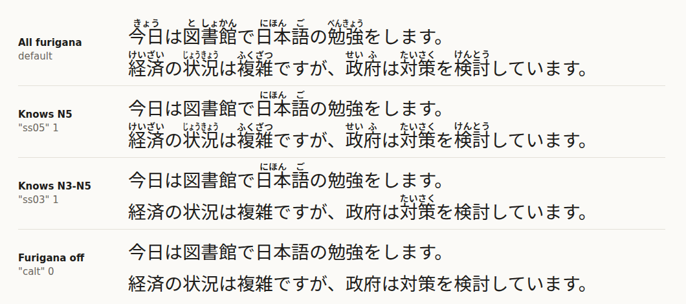

# Dandan

**Furigana that fade as you learn.** Dandan is a Japanese font whose OpenType ligatures draw furigana above
kanji words, so plain text shows readings with no `<ruby>` markup and no JavaScript. Its twist: it knows the
JLPT lists. Tell it which level you have reached and the words of that level (and the easier ones) lose their
readings, while the harder words keep them. The name is 段々 (*dandan*), "step by step".



```html
<p class="jp">今日は図書館で日本語の勉強をします。</p>

<style>
@font-face { font-family: "Dandan"; src: url("Dandan.woff2") format("woff2"); }
.jp { font-family: "Dandan"; line-height: 1.7; }
.knows-n4 { font-feature-settings: "ss04" 1; }  /* hide N5 and N4 readings */
.no-furigana { font-feature-settings: "calt" 0; }
</style>
```

Inspired by Anthony Fu's [Furifont](https://github.com/antfu/furifont), which proved the idea of furigana set
by the font itself. Dandan is an independent implementation in Python with fontTools; it shares no code with
Furifont.

## Features and switches

| Switch | Effect |
| --- | --- |
| `calt` (on by default) | Draws the furigana. **`font-feature-settings: "calt" 0` turns every furigana off.** `font-variant-ligatures: no-contextual` does the same. |
| `ss05` | Hides the readings of N5 words |
| `ss04` | Hides N5 and N4 |
| `ss03` | Hides N5 to N3 |
| `ss02` | Hides N5 to N2 |
| `ss01` | Hides every word on a JLPT list (only off-list words keep furigana) |

The stylistic sets switch levels at run time in one font file. The same choice can be baked in at build time
with `--level`: `--level N4` makes a font whose default `calt` already hides N5 and N4 words. A baked-in level
can be raised further with a stylistic set, never lowered.

Apps that expose stylistic sets (Word, InDesign, CSS) can use the switches; apps that only show the default
features get the build-time level.

## Use

Download the fonts from `dist/` after building (below), or build your own. Set `line-height` to **1.7** or more:

- the furigana's top reaches 1.34 em above the baseline; the font's ascender is raised to 1.36 em and its
  descender stays at 0.288 em, so `line-height: normal` is about 1.65;
- below about 1.6 the furigana of the first line can be clipped by a container with `overflow: hidden`, and
  below about 1.5 they touch the descenders of the line above.

Furigana are horizontal only. In vertical text (`writing-mode: vertical-rl`) shapers do not apply `calt`, so the
text stays plain.

## Build

Python 3.12 or later.

```sh
python3 -m venv .venv && .venv/bin/pip install -r requirements.txt
.venv/bin/python -m dandan fetch                       # base font + dictionaries into cache/ (about 60 MB)
.venv/bin/python -m dandan build --level N4 --family "Dandan N4"
.venv/bin/python -m dandan build-all                   # all, N5, N4, N3, N2, N1 into dist/
```

`build` writes `dist/<Family>.ttf`, `dist/<Family>.woff2` and `dist/<Family>.json` (glyph counts, budget,
features). Options:

| Option | Default | |
| --- | --- | --- |
| `--level N5\|N4\|N3\|N2\|N1\|all` | `all` | JLPT level already known: its words and easier ones stay bare |
| `--family NAME` | `Dandan` / `Dandan <level>` | Family name (never "Source" or "Noto": see Licenses) |
| `--dictionary full\|common` | `full` | `common`: JLPT and JMdict priority words only (about 15,000 glyphs, smaller font) |
| `--max-words N` | budget | Cap the number of annotated glyphs |
| `--weight`, `--furigana-weight` | 400, 600 | Weight of the text and of the furigana kana (variable base font) |
| `--scale` | 0.5 | Furigana size relative to the text |
| `--no-woff2` | | TTF only |

The first build prepares the subset base font and compiles the dictionary into `cache/`; later builds take about
a minute each.

### Demo

```sh
python3 -m http.server 8000     # from the repository root, after building
# open http://localhost:8000/demo/
```

`demo/index.html` loads `dist/Dandan.woff2` and has a level selector (stylistic sets) and a furigana toggle
(`calt`). The text is editable.

### Website

`site/` is the landing page: a Vue 3 + Vite static site with a JLPT level slider, a playground, the switches
and the downloads. It ships `Dandan.woff2` and `Dandan.ttf` in `site/public/fonts` (refresh them with
`pnpm fonts` after a build). See [site/DEPLOY.md](site/DEPLOY.md) to run it and deploy it to GitHub Pages or
Cloudflare Pages.

## How it works

```
JMdict ─┬─ (form, reading) pairs, priority tags, parts of speech
        │
JmdictFurigana ── which kana go over which kanji ──┐
                                                   ├─▶ Han runs + readings + JLPT level ─▶ annotated glyphs
JLPT lists (yomitan-jlpt-vocab) ── level per word ─┘                                      + GSUB lookups
Noto Sans JP (variable) ─▶ subset to JIS X 0208 + kana + Latin ─▶ instanced at 400 (text) and 600 (furigana)
```

1. **Han runs.** Browsers split text by script before shaping, so a font sees 食 and べる in separate runs.
   Every dictionary word is therefore cut into maximal runs of kanji, each with its aligned reading
   (`dandan/dictionary.py`).
2. **One reading or none.** A run collects the readings that common words (JMdict `news1`, `ichi1`, `spec`,
   `gai1` or a JLPT list) give it. Inside one JMdict entry the first listed reading wins (今日 is きょう, not
   こんにち); across entries a reading is kept only if its frequency weight is at least three times the next
   one. Otherwise the run stays bare: 2,166 runs are left bare this way, such as lone 食 (た, く, しょく).
   A lone kanji also stays bare when a common suffix, prefix or counter reads it differently (都 is みやこ
   alone but と in 東京都), and so do a few counters after digits (日 月 年 時 本 分 人 ...).
3. **Glyphs.** Each kept (run, reading) becomes one TrueType composite glyph: the base kanji glyphs side by side
   plus the kana scaled to 0.5 above them, drawn from a heavier (600) instance of the variable font so that the
   small kana keep their colour. When each kanji's reading fits over it, it is centred there (日[に]本[ほん]
   語[ご]); otherwise the whole reading is centred over the word and condensed to its width, so furigana never
   spill into the next word (`dandan/glyphs.py`).
4. **Rules** (`dandan/gsub.py`), appended to the base font's GSUB in this order:
   - `words`: ligatures of two or more kanji. The longest sequence is tried first, so 日本語 beats 日本.
   - `okurigana`: a lone kanji followed by a given kana takes that word's reading (食 + べ: た over 食 only).
   - `kanji`: a lone kanji takes its one unambiguous reading (見る: み).
   - `hide N5` ... `hide N1`: multiple substitutions turning the annotated glyph of a listed word back into its
     plain kanji. Because they run after the ligatures, a known word still wins the longest match, so its
     kanji are never annotated one by one.
5. **Glyph budget.** OpenType allows 65,535 glyphs. The subset base font keeps 7,860 (JIS X 0208 with its
   6,355 level 1 and level 2 kanji, kana, Latin, punctuation, plus the furigana kana). With 64 ids kept in
   reserve, 57,611 remain for words. The full dictionary offers 136,639 candidates, so it is capped: JLPT
   words first, then JMdict priority words by frequency, then the other JMdict words, those written with level
   1 kanji only and shorter ones first. Result: 65,471 glyphs.
6. **Metrics.** The ascender (hhea, typo, win) is raised from 1160 to just above the furigana top.

## Sizes

Full dictionary, Regular, 65,471 glyphs:

| Level | WOFF2 | TTF |
| --- | --- | --- |
| `all` (`Dandan.woff2`) | 1,888,560 bytes (1.80 MiB) | 6.89 MiB |
| `N5` (`Dandan-N5.woff2`) | 1,888,232 bytes (1.80 MiB) | 6.89 MiB |
| `N4` (`Dandan-N4.woff2`) | 1,888,480 bytes (1.80 MiB) | 6.89 MiB |
| `N3` (`Dandan-N3.woff2`) | 1,887,568 bytes (1.80 MiB) | 6.89 MiB |
| `N2` (`Dandan-N2.woff2`) | 1,888,380 bytes (1.80 MiB) | 6.89 MiB |
| `N1` (`Dandan-N1.woff2`) | 1,886,852 bytes (1.80 MiB) | 6.89 MiB |

Every level has the same glyphs: a known word still needs its ligature to win the longest match, so only the
rules differ. `--dictionary common` gives 23,098 glyphs and a WOFF2 of about 1.3 MB.

## Tests

```sh
.venv/bin/python -m pytest
```

The shaping tests run HarfBuzz (uharfbuzz) on the fonts in `dist/` (or build them into a temporary directory):
今日 is one annotated ligature, 日本語 beats 日本, an N5 word is bare in the N5 build and annotated in `all`,
`ss05`/`ss03` hide levels at run time, `calt` off leaves text bare, okurigana readings sit over the kanji only,
vertical text is left alone, and the glyph count is under 65,535.

`scripts/render.py docs/sample.html docs/sample.png 1000x620` renders the sample above with headless Chrome,
so the picture shows what a browser draws.

## Limitations

- **Readings can be wrong.** A font sees a run of kanji, not the sentence. Greedy longest match can cut a run
  in the wrong place, a word read differently in context (人気 にんき / ひとけ) gets its most frequent reading,
  and uncommon JMdict compounds can grab a longer match than the text meant.
- **Okurigana in browsers.** Contextual rules (食 + べ) need the shaper to see kanji and kana together. HarfBuzz
  does when given the whole string, but browsers shape them as separate runs, so in a browser only the lone
  kanji rule applies, and ambiguous kanji such as 食, 行, 話 stay bare. Godan, ichidan and i-adjective endings
  are expanded to their conjugated first kana; irregular verbs are skipped.
- **JLPT data is an estimate.** There is no official list since 2010; Waller's lists (via yomitan-jlpt-vocab)
  put 日本 at N3 and leave out 日本語, for example.
- **Size.** About 1.8 MB of WOFF2 for the full dictionary; use `--dictionary common` or `--max-words` for less.
- **Horizontal only**, one weight per build, hiragana furigana only (katakana words keep their katakana reading).
- Kanji outside JIS X 0208 (plus 𠮟塡剝頰) are not in the subset font, and words using them are skipped.

## Licenses

- **Code:** [MIT](LICENSE), Alexis MABANZA.
- **Fonts:** [SIL Open Font License 1.1](OFL.txt), derived from Noto Sans JP (Copyright 2014-2021 Adobe, with
  Reserved Font Name "Source"). The output family is "Dandan" and does not use "Source" or "Noto".
- **Dictionary data** (not committed; embedded in the built fonts as reading tables): CC BY-SA 4.0, from JMdict
  (EDRDG), JmdictFurigana and yomitan-jlpt-vocab (from Jonathan Waller's JLPT lists, CC BY). See
  [DATA_SOURCES.md](DATA_SOURCES.md) for URLs, versions and checksums.

## Credits

- [Furifont](https://github.com/antfu/furifont) by Anthony Fu, the inspiration: furigana drawn by the font,
  and the finding that browsers shape kanji and kana in separate runs.
- [Noto Sans JP](https://fonts.google.com/noto/specimen/Noto+Sans+JP) by Adobe and Google.
- [JMdict](https://www.edrdg.org/jmdict/j_jmdict.html) by the EDRDG,
  [JmdictFurigana](https://github.com/Doublevil/JmdictFurigana) by Doublevil,
  [yomitan-jlpt-vocab](https://github.com/stephenmk/yomitan-jlpt-vocab) by stephenmk and Jonathan Waller's
  [JLPT resources](http://www.tanos.co.uk/jlpt/).
- [fontTools](https://github.com/fonttools/fonttools) and [HarfBuzz](https://harfbuzz.github.io/).
