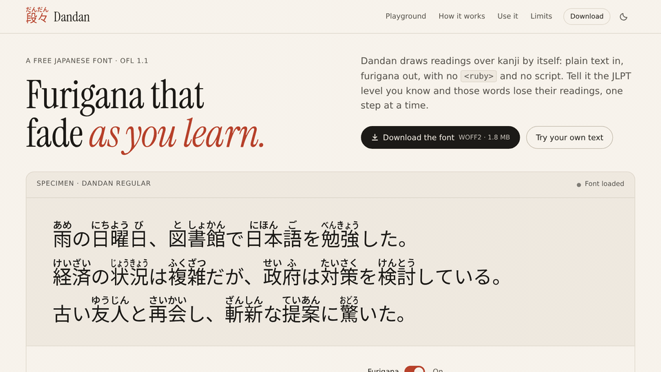
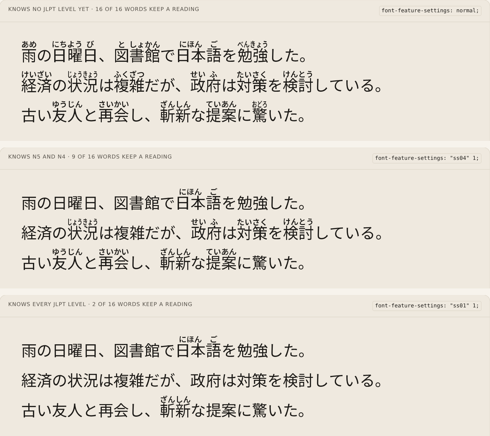
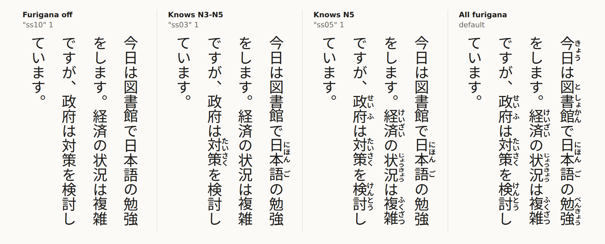
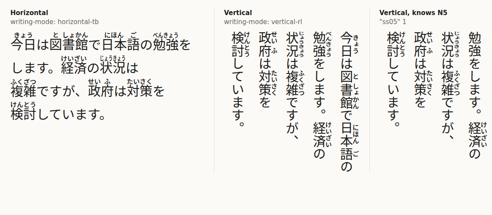
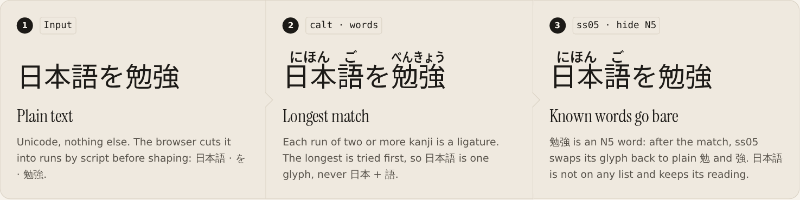
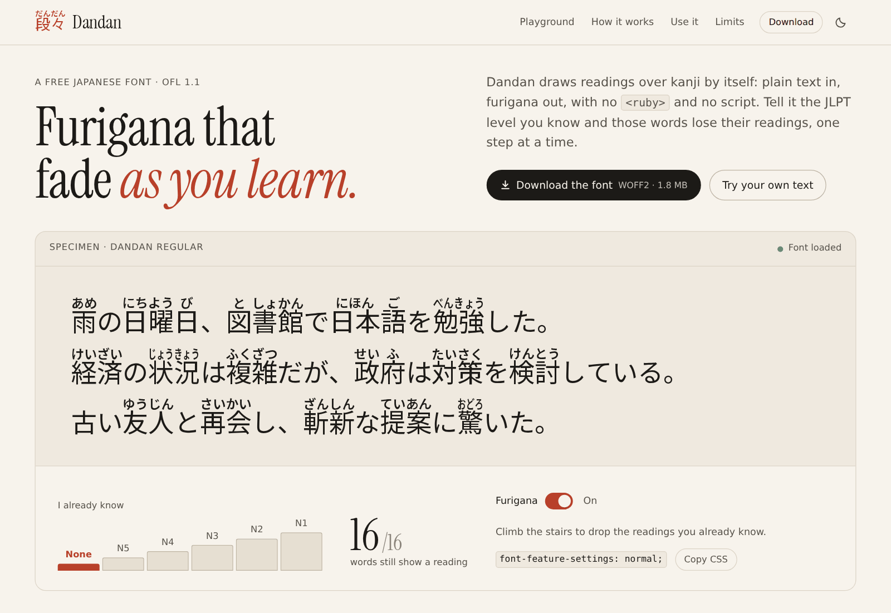
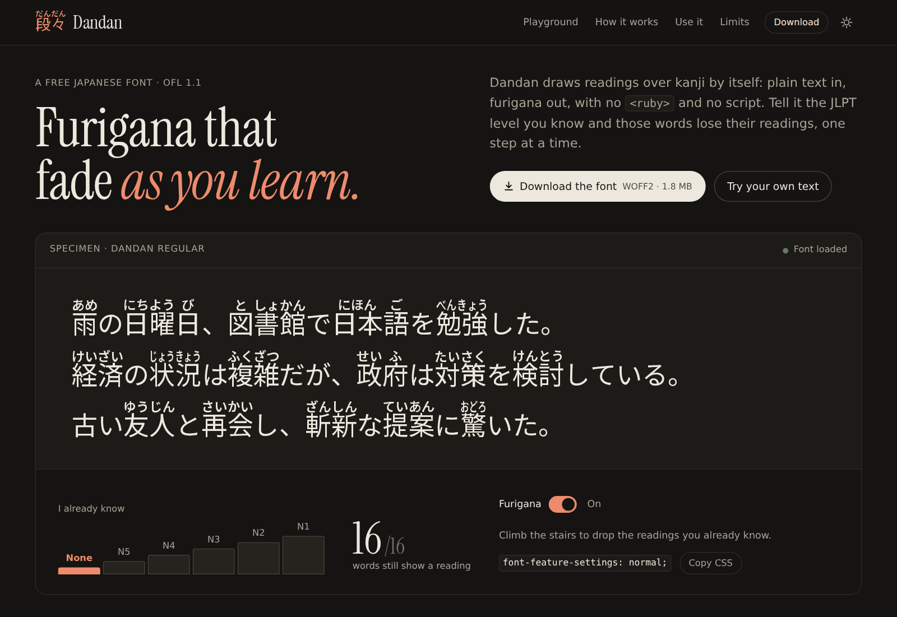
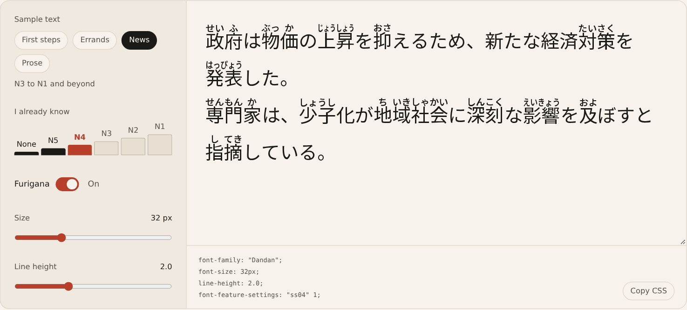

# Dandan 段々

[](https://github.com/Alexvolkihar/dandan/actions/workflows/ci.yml)

A Japanese font that draws furigana over kanji by itself, and drops the readings of the JLPT words you
already know.

[](docs/images/demo.mp4)

<sub>24-second demo of the website, also as [MP4](docs/images/demo.mp4).</sub>

**Live site: [dandan.alexvolkihar.ovh](https://dandan.alexvolkihar.ovh)** (specimen, playground, download)

## What it does

Dandan is built on Noto Sans JP. Its OpenType ligatures replace each kanji word with a glyph that carries its
reading above it, so plain text gets furigana with no `<ruby>` markup and no JavaScript. About 57,600 words are
annotated, JLPT vocabulary first. A second font, Dandan Vertical, sets the readings beside the kanji in
[vertical text](#vertical-text), and a third, Dandan Duo, does [both](#both-directions-dandan-duo).

| Font | Pick it for | Words with a reading | WOFF2 |
| --- | --- | --- | --- |
| **Dandan** | horizontal text: the lightest, and the most words | 57,611 | 1.8 MB |
| **Dandan Vertical** | vertical text (tategaki) only | 57,410 | 2.0 MB |
| **Dandan Duo** | pages that set Japanese both ways, with one font | 28,705 per direction | 1.9 MB |

Stylistic sets tell the font what the reader already knows. Each one hides the readings of a JLPT level and
every easier level, while harder words keep theirs. The name 段々 (*dandan*) means "step by step".

| `font-feature-settings` | The reader knows | Readings hidden |
| --- | --- | --- |
| `normal` | nothing yet | none |
| `"ss05" 1` | N5 | N5 words |
| `"ss04" 1` | N5 and N4 | N5 to N4 |
| `"ss03" 1` | N5 to N3 | N5 to N3 |
| `"ss02" 1` | N5 to N2 | N5 to N2 |
| `"ss01" 1` | every level | every word on a JLPT list (off-list words keep their reading) |
| `"calt" 0` | | all of them: no furigana at all (same as `font-variant-ligatures: no-contextual`) |



One font file switches levels at run time. Apps that expose stylistic sets (CSS, InDesign, Word) can use the
switches; for apps that only apply default features, a level can be baked in at build time (see below).

## Quick start

```css
@font-face {
  font-family: "Dandan";
  src: url("Dandan.woff2") format("woff2");
  font-display: swap;
}

.jp {
  font-family: "Dandan", sans-serif;
  line-height: 1.8;         /* furigana need 1.7 or more */
  word-break: auto-phrase;  /* wrap between words (Chromium, with lang="ja") */
}

.knows-n4 { font-feature-settings: "ss04" 1; }  /* hide N5 and N4 readings */
.plain    { font-feature-settings: "calt" 0; }  /* no furigana */
```

```html
<p lang="ja" class="jp knows-n4">経済の状況は複雑だが、政府は対策を検討している。</p>
```

Keep `line-height` at 1.7 or more. The furigana reach 1.34 em above the baseline and the font's ascender is
raised to 1.36 em, so `line-height: normal` comes out at about 1.65. Below about 1.6 a container with
`overflow: hidden` can clip the first line's furigana, and below about 1.5 they touch the line above.

`word-break: auto-phrase` matters because a line break inside a word splits it into two runs, and each half
may then get a reading of its own.

## Vertical text

Vertical text (tategaki) has its own font, **Dandan Vertical**. Its readings sit to the right of each kanji,
upright and in their vertical forms (small kana in the upper right of their cell), centred along the kanji
they belong to, as in printed Japanese.



```css
@font-face {
  font-family: "Dandan Vertical";
  src: url("Dandan-Vertical.woff2") format("woff2");
  font-display: swap;
}

.tate {
  writing-mode: vertical-rl;
  font-family: "Dandan Vertical", sans-serif;
  line-height: 2.1;         /* furigana need 2.0 or more */
}

.tate.knows-n4 { font-feature-settings: "ss04" 1; }  /* same stylistic sets as Dandan */
.tate.plain    { font-feature-settings: "ss10" 1; }  /* no furigana */
```

Keep `line-height` at 2.0 or more. A vertical line is centred on the em box and the readings reach 0.46 em
to the right of it, into the space between columns. The font's ascender and descender are set so that
`line-height: normal` comes out at 2.0; below that, a container with `overflow: hidden` can clip the readings
of the first (rightmost) column, and below about 1.5 they touch the next column.

Shapers apply `calt` only in horizontal text and `vert` only in vertical text, so Dandan Vertical carries its
word rules in `vert` and `vrt2`. `"calt" 0` therefore does nothing in vertical text; `"ss10" 1` hides every
reading instead. In horizontal text Dandan Vertical shows plain kanji, and Dandan shows plain kanji in vertical
text: use each font in its own direction, or Dandan Duo for both.

## Both directions: Dandan Duo

**Dandan Duo** carries Dandan's rules and Dandan Vertical's in one file. The text's `writing-mode` picks the set:
readings above the kanji in horizontal text, right of them in vertical text, with no feature flag to change.



```css
@font-face {
  font-family: "Dandan Duo";
  src: url("Dandan-Duo.woff2") format("woff2");
  font-display: swap;
}

.jp      { font-family: "Dandan Duo", sans-serif; line-height: 1.8; }
.jp.tate { writing-mode: vertical-rl; line-height: 2.1; }  /* vertical readings need 2.0 or more */

.knows-n4 { font-feature-settings: "ss04" 1; }           /* same stylistic sets in both directions */
.plain    { font-feature-settings: "calt" 0, "ss10" 1; }  /* no furigana in either direction */
```

In each direction it shapes text exactly as the single-direction font with the same words does (the tests check
this glyph by glyph with HarfBuzz, and headless Chrome draws the same pixels), with three differences:

- **Half the words.** OpenType caps a font at 65,535 glyphs, and the Duo needs a horizontal and a vertical glyph
  for each word, so each direction gets 28,705 words instead of about 57,500. That still covers every JLPT word
  and every JMdict priority word, with the commonest of the rest; the rarer compounds lose their reading (or are
  read kanji by kanji, as 朝早く is).
- **Switches.** As in each font, `"calt" 0` turns horizontal readings off and `"ss10" 1` vertical ones. Combine
  them to turn every reading off.
- **Line height.** The Duo keeps Dandan's ascender and descender, so horizontal text sits exactly as in Dandan,
  and `line-height: normal` is about 1.65 in both directions. Vertical lines need 2.0 or more, so set it.

Pick Dandan or Dandan Vertical when a page uses only one direction: they annotate twice as many words.

## Download

- From the website: [dandan.alexvolkihar.ovh](https://dandan.alexvolkihar.ovh), WOFF2 (1.8 MB) or TTF (6.9 MB),
  Dandan Vertical as WOFF2 (2.0 MB) or TTF (7.3 MB), and Dandan Duo as WOFF2 (1.9 MB) or TTF (7.2 MB).
- From this repository: [`site/public/fonts/`](site/public/fonts) holds `Dandan.woff2`, `Dandan.ttf`,
  `Dandan-Vertical.woff2`, `Dandan-Vertical.ttf`, `Dandan-Duo.woff2`, `Dandan-Duo.ttf`, the OFL and the
  attribution notice. Keep `OFL.txt` and `NOTICE.txt` next to the font when you redistribute it.
- From the [GitHub releases](https://github.com/Alexvolkihar/dandan/releases): every level of the three fonts.

These files are the `all` build (every reading shown by default, levels picked with stylistic sets). Fonts
with a level baked in come from a build.

## Build from source

Python 3.12 or later.

```sh
python3 -m venv .venv && .venv/bin/pip install -r requirements.txt
.venv/bin/python -m dandan fetch                       # base font + dictionaries into cache/ (about 60 MB)
.venv/bin/python -m dandan build                       # dist/Dandan.ttf, .woff2, .json
.venv/bin/python -m dandan build --level N4 --family "Dandan N4"
.venv/bin/python -m dandan build --orientation vertical  # dist/Dandan-Vertical.ttf, .woff2, .json
.venv/bin/python -m dandan build --orientation both      # dist/Dandan-Duo.ttf, .woff2, .json
.venv/bin/python -m dandan build-all                   # all, N5 ... N1, of all three fonts, into dist/
```

`build` writes `dist/<Family>.ttf`, `dist/<Family>.woff2` and `dist/<Family>.json` (glyph counts, budget,
features). `fetch` records the URL and SHA-256 of every download in `cache/manifest.json`.

| Option | Default | |
| --- | --- | --- |
| `--level N5\|N4\|N3\|N2\|N1\|all` | `all` | Level already known: its words and the easier ones are bare by default (`build` only) |
| `--orientation horizontal\|vertical\|both` | `horizontal` | `vertical` builds Dandan Vertical, `both` Dandan Duo (`build-all` also takes `all`, its default: the three fonts) |
| `--family NAME` | `Dandan` / `Dandan <level>` | Family name (`Dandan Vertical`, `Dandan Duo`, plus ` <level>`, for the other orientations); never "Source" or "Noto" (see Licences) |
| `--dictionary full\|common` | `full` | `common`: JLPT and JMdict priority words only (23,098 glyphs, WOFF2 about 1.3 MB) |
| `--max-words N` | glyph budget | Cap the number of annotated glyphs (per direction for Dandan Duo) |
| `--weight`, `--furigana-weight` | 400, 600 | Weight of the text and of the furigana kana |
| `--scale` | 0.5 | Furigana size relative to the text |
| `--out DIR` | `dist` | Output directory |
| `--no-woff2` | | TTF only |

A baked-in level can be raised further with a stylistic set, never lowered: `--level N4` with `"ss02" 1` hides
N5 to N2. The first build prepares the subset base font and compiles the dictionary into `cache/`; later
builds take about a minute each.

Every level build has the same 65,471 glyphs and the same size (1,888,560 bytes of WOFF2 for `all`, within a
few hundred bytes for the others; 6.9 MB of TTF). A known word still needs its ligature to win the longest
match, so only the rules differ. A vertical build also has 65,471 glyphs: 8,061 base glyphs, since it adds the
vertical forms of the furigana kana, and 57,410 words (2,053,236 bytes of WOFF2, 7.3 MB of TTF; its `ss10`
lookup adds about 160 KB). Dandan Duo has the vertical build's 8,061 base glyphs and 28,705 words in each
direction, 65,471 glyphs again (2,003,528 bytes of WOFF2, 7.2 MB of TTF).

`demo/index.html` is a bare test page for the built font: serve the repository root with
`python3 -m http.server 8000` and open `http://localhost:8000/demo/`.

## How it works



```
JMdict ─┬─ (form, reading) pairs, priority tags, parts of speech
        │
JmdictFurigana ── which kana go over which kanji ──┐
                                                   ├─▶ Han runs + readings + JLPT level ─▶ annotated glyphs
JLPT lists (yomitan-jlpt-vocab) ── level per word ─┘                                      + GSUB lookups
Noto Sans JP (variable) ─▶ subset to JIS X 0208 + kana + Latin ─▶ instanced at 400 (text) and 600 (furigana)
```

1. **Han runs.** Browsers split text by script before shaping, so the font sees 食 and べる in separate runs.
   Every dictionary word is cut into maximal runs of kanji, each with its aligned reading
   (`dandan/dictionary.py`).
2. **One reading or none.** A run keeps a reading only when common words clearly agree on it. Inside one JMdict
   entry the first listed reading wins (今日 is きょう, not こんにち); across entries a reading must weigh at least
   three times the next one. Otherwise the run stays bare: 2,166 runs end up bare this way, lone 食 (た, く,
   しょく) among them. A lone kanji also stays bare when a common affix or counter reads it differently (都 is
   みやこ alone but と in 東京都).
3. **Glyphs.** Each kept (run, reading) pair becomes one TrueType composite glyph: the base kanji side by side,
   with the kana at half size above them, taken from a weight-600 instance so the small kana keep their colour.
   A reading sits over its own kanji when it fits (日[に]本[ほん]語[ご]); otherwise it is centred over the word
   and condensed to its width (`dandan/glyphs.py`).
4. **Rules** (`dandan/gsub.py`), appended to the base font's GSUB in this order:
   - `words`: ligatures of two or more kanji, longest first, so 日本語 beats 日本;
   - `okurigana`: a lone kanji followed by a given kana takes that word's reading (食 + べ: た);
   - `kanji`: a lone kanji takes its one unambiguous reading (見る: み);
   - `hide N5` to `hide N1`: turn the annotated glyph of a listed word back into its plain kanji. They run after
     the ligatures, so a known word still wins the longest match and its kanji are never annotated one by one.
5. **Glyph budget.** OpenType allows 65,535 glyphs. The subset base font keeps 7,860 (JIS X 0208 with its 6,355
   level 1 and 2 kanji, kana, Latin, punctuation and the furigana kana); with 64 ids in reserve, 57,611 remain
   for words. The full dictionary offers 136,639 candidates, taken in this order: JLPT words, JMdict priority
   words by frequency, then other JMdict words (level 1 kanji and shorter words first).
6. **Metrics.** The ascender (hhea, typo, win) is raised from 1160 to 1360 units, just above the furigana.
7. **Vertical build** (`--orientation vertical`). The same words become composites with the kanji stacked one
   vertical advance apart and the kana, at half size and in their vertical forms, in a column starting 960
   units right of the column's left edge. The glyph keeps its first kanji's horizontal advance (so browsers
   centre the kanji in the line) and vertical origin, and its vertical advance is the sum of the kanji's. The
   rules hang on the base font's `vert` and `vrt2` features, after its own lookups, so the okurigana rule sees
   kana already in their vertical forms; `ss10` adds a hide lookup for the words on no JLPT list. The ascender
   and descender are set 1000 units either side of the em box's centre (`line-height: normal` = 2.0), and
   `vhea`'s ascender covers the furigana. The font is TrueType, so it needs no `VORG`: the vertical origin
   comes from `vmtx`.
8. **Duo build** (`--orientation both`). The vertical base font gets the horizontal glyphs of the first 28,705
   words, then their vertical glyphs (names `fu…` and `fv…`, so none is drawn twice); the base glyphs, kanji and
   both sets of furigana kana are shared. The lookup list is the base font's, then the vertical words,
   okurigana and kanji lookups, the horizontal ones, the vertical hide lookups (N5 to N1, then off-list words)
   and the horizontal ones. Each direction keeps its own order. `calt` holds the horizontal rules and
   `vert`/`vrt2` the vertical ones, so each fires in its own direction only; `ss05` to `ss01` list the hide
   lookups of both directions, and `ss10` the vertical ones, but a hide lookup only matches its own
   direction's glyphs, so in each direction the other set's lookups find nothing to do. Should a page force
   `calt` on in vertical text, the vertical words are already formed when the horizontal lookups run, and the
   vertical hides run after both, so the text still shapes as in Dandan Vertical.
   The ascender and descender are Dandan's, and `vhea`'s ascender covers the vertical readings.

The [How it works](https://dandan.alexvolkihar.ovh/#how) section of the website walks through the same steps.
[DATA_SOURCES.md](DATA_SOURCES.md) lists every input with its version and licence.

## Limitations

- **Readings can be wrong.** A font sees a run of kanji, not the sentence. The longest match can cut a run in
  the wrong place, a word with two readings (人気: にんき or ひとけ) always gets its most frequent one, and a
  rare JMdict compound can grab more text than the writer meant. Check readings that matter.
- **Okurigana rules don't apply in browsers.** Browsers shape kanji and kana as separate runs, so the font never
  sees 食 next to べ. Only the lone-kanji rule applies there, and kanji with several readings (食, 行, 話) stay
  bare. HarfBuzz given a whole string does apply them. Irregular verbs are skipped.
- **JLPT levels are an estimate.** There has been no official vocabulary list since 2010. Waller's lists put
  日本 at N3 and leave 日本語 out, for example, so 日本語 keeps its reading even with `ss01`.
- **Size.** About 1.8 MB of WOFF2 for the full dictionary. `--dictionary common` (about 1.3 MB) or
  `--max-words` give a smaller file.
- **One font per direction, or half the words.** Shapers skip `calt` in vertical writing, so Dandan stays plain
  in `writing-mode: vertical-rl`; Dandan Vertical covers vertical text, and stays plain in horizontal text. A
  page that mixes both loads the two fonts, or Dandan Duo, which annotates half as many words per direction. Vertical readings are condensed along the word when they are longer than it
  (状況: じょうきょう), as horizontal ones are across it; nothing lets them overhang the kana around them.
  Only Chromium was checked in a browser.
- **Coverage.** Kanji outside JIS X 0208 (plus 𠮟, 塡, 剝, 頰) are not in the font, and words using them get
  no reading. Furigana are hiragana only, and each build has one weight.

## Website

[`site/`](site) is the landing page at [dandan.alexvolkihar.ovh](https://dandan.alexvolkihar.ovh): a static
Vue 3 + Vite site with the level staircase, a playground, the switches and the downloads. It follows the
system theme and has a light/dark toggle. The playground switches to vertical text, and only then fetches
Dandan Vertical. The downloads offer the three fonts.

<p>
  
  
</p>



```sh
cd site
pnpm install
pnpm fonts   # copy ../dist/Dandan*.woff2, *.ttf and ../OFL.txt into public/fonts (build the three fonts first)
pnpm dev     # local dev server
pnpm build   # static output in site/dist
```

[site/DEPLOY.md](site/DEPLOY.md) covers hosting on GitHub Pages or Cloudflare Pages.

## Browser extension

[`extension/`](extension) is a Chrome and Firefox extension (Manifest V3) that sets the Japanese text of any
website in Dandan. A toolbar popup turns it on per site (it asks for access to that site only) or for all sites,
and picks the JLPT level, main text or whole page, and the line height. It leaves `<ruby>`, code and form fields
alone, follows pages that add text later, makes no network requests and has no analytics.

```sh
cd extension
node scripts/build.mjs   # dist/chrome/, dist/firefox/ and a zip for each store
```

Load `extension/dist/chrome` with *Load unpacked* in `chrome://extensions`, or `extension/dist/firefox` as a
temporary add-on in `about:debugging`. [extension/README.md](extension/README.md) covers the features, the
permissions and the limits; [extension/PRIVACY.md](extension/PRIVACY.md) is the privacy policy.

## Tests

```sh
.venv/bin/python -m pytest
```

The 44 tests check the dictionary compiler and run HarfBuzz (uharfbuzz) on the fonts in `dist/`, building them
into a temporary directory when needed: 今日 is one annotated ligature, 日本語 beats 日本, an N5 word is bare in
the N5 build and annotated in `all`, `ss05` and `ss03` hide levels at run time, `calt` off leaves text bare,
okurigana readings sit over the kanji only, Dandan leaves vertical text alone, and the glyph count stays under
65,535. In top-to-bottom text, Dandan Vertical makes 日本語 one ligature whose vertical advance is the sum of
its kanji's, sets the reading right of the column with ょ in its vertical form, hides levels with `ss05` and
`ss03` and every reading with `ss10`, still turns 。 and ー, and leaves horizontal text bare.

The Dandan Duo tests build Dandan and Dandan Vertical capped at the Duo's 28,705 words per direction, then shape
25 sentences with 14 feature settings (no features, `ss05` to `ss01`, `ss10`, `calt`, `vert` and `liga` off,
and combinations) in both directions: the Duo's glyphs, clusters, advances and offsets must match Dandan's in
horizontal text and Dandan Vertical's in top-to-bottom text. They also check that each direction only ever
produces its own glyphs, that the two directions split the glyph budget, and that the line metrics are Dandan's.
They compare the `all` and `N4` builds; `DANDAN_PARITY_LEVELS=all,N5,N4,N3,N2,N1` compares every level.

`scripts/render.py docs/sample.html docs/sample.png 1000x620` renders [a sample page](docs/sample.png) with
headless Chrome, to check what a browser draws; `scripts/render.py docs/vertical.html docs/images/vertical.png
1240x500` does the same for [the vertical one](docs/images/vertical.png), and `scripts/render.py docs/duo.html
docs/images/duo.png 1140x500` for [Dandan Duo](docs/images/duo.png).

## CI and deployment

[`ci.yml`](.github/workflows/ci.yml) runs on every push to `master` and every pull request, in two jobs:

- `site`: `pnpm install --frozen-lockfile` and `pnpm build` in `site/` (pnpm 11, Node 22);
- `python`: on Python 3.12 and 3.14, `python -m dandan fetch` then `python -m pytest -v`, which builds the
  fonts the shaping tests need (`all`, `N5`, the vertical `all`, the Duo `all` and `N4`, and the capped
  references of the Duo tests). The downloaded sources are cached under a key that follows the pins in
  `dandan/fetch.py`, so a new pin downloads everything again.

Vercel deploys the site on its own: every push to `master` goes live at
[dandan.alexvolkihar.ovh](https://dandan.alexvolkihar.ovh), and every pull request gets a preview URL. The
Vercel project builds `site/` with `pnpm build`; the CI run is a separate check on the same commit.

[`release.yml`](.github/workflows/release.yml) runs on a `v*` tag (`git tag v0.2.0 && git push origin v0.2.0`):
it builds every level of Dandan, Dandan Vertical and Dandan Duo with `build-all`, runs the tests on those fonts
(comparing the Duo with its references at every level), and attaches the WOFF2 and TTF files, `OFL.txt` and
`NOTICE.txt` to a GitHub Release.

## Credits

- [Furifont](https://github.com/antfu/furifont) by Anthony Fu showed that a font can set its own furigana, and
  that browsers shape kanji and kana in separate runs. Dandan is a separate implementation in Python with
  fontTools and shares no code with it.
- [Noto Sans JP](https://fonts.google.com/noto/specimen/Noto+Sans+JP) by Adobe and Google, for every outline.
- [JMdict](https://www.edrdg.org/jmdict/j_jmdict.html) by the Electronic Dictionary Research and Development
  Group (EDRDG), for words, readings and frequency tags.
- [JmdictFurigana](https://github.com/Doublevil/JmdictFurigana) by Doublevil, for which kana go over which kanji.
- [yomitan-jlpt-vocab](https://github.com/stephenmk/yomitan-jlpt-vocab) by stephenmk, built on Jonathan
  Waller's [JLPT lists](http://www.tanos.co.uk/jlpt/), for the levels.
- [fontTools](https://github.com/fonttools/fonttools) and [HarfBuzz](https://harfbuzz.github.io/).

## Licences

| What | Licence |
| --- | --- |
| Code (`dandan/`, `scripts/`, `site/`, tests) | [MIT](LICENSE), Alexis MABANZA |
| Fonts (outlines, furigana glyphs, OpenType rules) | [SIL Open Font License 1.1](OFL.txt). Derived from Noto Sans JP, Copyright 2014-2021 Adobe, Reserved Font Name "Source"; the family name "Dandan" uses neither "Source" nor "Noto". |
| Reading data inside the fonts | [CC BY-SA 4.0](https://creativecommons.org/licenses/by-sa/4.0/), from JMdict (EDRDG), JmdictFurigana and yomitan-jlpt-vocab (Waller's lists are CC BY) |

The dictionary files themselves are not committed; `dandan fetch` downloads them. Anyone redistributing a
modified font or the reading data keeps these attributions and the share-alike terms. The full notice is in
[`site/public/fonts/NOTICE.txt`](site/public/fonts/NOTICE.txt), and sources, versions and checksums are in
[DATA_SOURCES.md](DATA_SOURCES.md).
