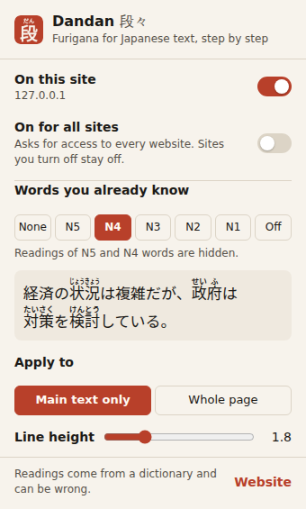
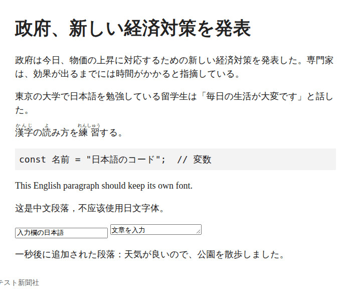
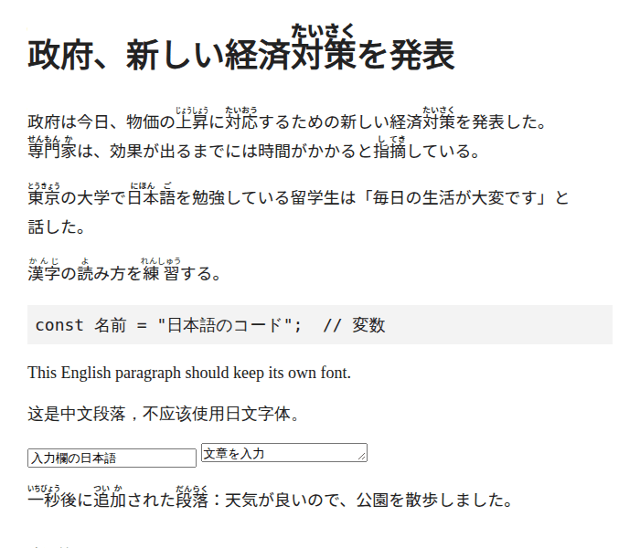

# Dandan Furigana: browser extension

A small Chrome and Firefox extension (Manifest V3) that sets the Japanese text of any website in the
[Dandan](https://dandan.alexvolkihar.ovh) font, so kanji get furigana, and hides the readings of the JLPT words
you already know.

<p>
  
</p>

| Before | After (level N3: N5 to N3 words stay bare) |
| --- | --- |
|  |  |

## Features

- **Per site.** The extension does nothing on a site until you turn it on there from the toolbar popup. It then
  remembers the choice and applies itself on every later visit.
- **Or everywhere.** "On for all sites" applies it to every website, except the sites you turned off.
- **JLPT level.** None (every reading), N5 to N1 (the readings of that level and the easier ones are hidden), or
  Off (the font without furigana). The popup shows a preview sentence at the chosen level.
- **Scope.** "Main text only" (articles, paragraphs, lists, headings, quotes, tables; not navigation, menus,
  buttons or the site's header and footer) or "Whole page".
- **Line height.** 1.6 to 2.4, default 1.8. Furigana need about 1.7 to clear the line above.
- **Live.** Changes apply to open tabs at once, and text that a page adds later (infinite scroll, single-page
  apps) is picked up as it appears.
- **Popup in English, French and Japanese**, following the browser language.

### What it touches, and what it leaves alone

Only elements whose own text is Japanese get the font: Han or kana in a part of the page marked `lang="ja"`, or,
when nothing says so, text with kana in it (or any Han text on a page that looks Japanese). Kanji-only text on a
non-Japanese page is left alone, as it may be Chinese.

It never changes code (`code`, `pre`, `kbd`, `samp`), form fields, editable areas, elements whose `lang` says
another language, and `<ruby>`: text that already has furigana keeps them, without a second set from the font.

The font is only used for Han, kana, CJK punctuation and full-width forms (`unicode-range`), so Latin text keeps
the page's font, and characters missing from Dandan fall back to the page's own fonts.

## Install (unpacked)

Build the packages first (Node 22.2 or later, no dependencies):

```sh
cd extension
node scripts/build.mjs   # dist/chrome/, dist/firefox/, dist/dandan-chrome-<version>.zip, dist/dandan-firefox-<version>.zip
```

The font and its licences are copied from `site/public/fonts/`.

**Chrome, Edge, Brave and other Chromium browsers (120 or later):** open `chrome://extensions`, turn on
*Developer mode*, click *Load unpacked* and pick `extension/dist/chrome`.

**Firefox (140 or later):** open `about:debugging#/runtime/this-firefox`, click *Load Temporary Add-on…* and
pick `extension/dist/firefox/manifest.json`. A temporary add-on is removed when Firefox closes; a permanent
install needs the package signed by Mozilla (see Publishing).

Then pin the extension to the toolbar, open a Japanese page, click the 段 icon and turn on *On this site*. The
browser asks for access to that site.

## How it works

- `content.js` walks the page's text nodes in short idle-time slices (about 10 ms each), tests each one with a
  regular expression for Han and kana, and adds the `dandan-jp` class to the parent element of the Japanese
  ones. A `MutationObserver` queues new and changed nodes for the same treatment.
- `background.js` inserts the stylesheet with `scripting.insertCSS`, which page Content Security Policies do
  not block: an `@font-face` pointing at the bundled `fonts/Dandan.woff2` (`runtime.getURL`), the level and line
  height rules in `content.css`, and one `font-family: "Dandan-ext", <original fonts>` rule per font stack the
  page uses.
- Every rule depends on attributes on `<html>` (`data-dandan`, `data-dandan-level`, `data-dandan-lh`), so a
  level change is one attribute write, and turning the site off removes them.
- The content script is registered with `scripting.registerContentScripts` for the enabled sites only, and
  re-registered when settings or permissions change.

## Permissions and privacy

`storage`, `activeTab` and `scripting`, plus site access requested at run time (`optional_host_permissions`):
one site when you turn it on, all sites only if you choose "On for all sites". Turning a site off gives its
access back. There are no network requests and no analytics; settings stay in local storage. See
[PRIVACY.md](PRIVACY.md).

## Limitations

- **Readings can be wrong.** The font sees runs of kanji, not sentences: a word with two readings gets its most
  frequent one, and the longest match can cut a run in the wrong place. See the main README.
- **Layout may shift.** Japanese text gets a taller line height and a different font. Elements with a fixed
  height or `overflow: hidden` can clip the first line's furigana, and a few sites may wrap differently.
- **Coverage.** Dandan has the JIS X 0208 kanji only: rarer kanji are drawn by the page's fonts, without
  readings. Horizontal text only: vertical text (`writing-mode: vertical-rl`) stays plain.
- **Detection is heuristic.** Kanji-only snippets on a page that is not marked as Japanese are skipped; a page
  that mislabels its language may be under- or over-matched.
- **Top frame only.** Text inside iframes is not changed.
- **Size.** The package is about 1.9 MB, nearly all of it the font.

## Publishing

Not published yet. The zips in `dist/` are what the stores take.

- **Chrome Web Store:** a developer account (one-time US$5 fee, identity verification), the zip, a 128 px
  icon, at least one 1280×800 screenshot, a description, the privacy policy URL and the justification of each
  permission (single purpose, host permissions requested at run time). Review usually takes a few days.
- **Firefox Add-ons (AMO):** a free Mozilla account, the zip, and the source code if asked (the package is not
  minified, so it is its own source). `data_collection_permissions` is set to none. Listed add-ons are reviewed;
  an unlisted one can be signed for self-distribution.

## Files

| Path | |
| --- | --- |
| `src/manifest.json` | Shared manifest; `scripts/build.mjs` adds the Chrome service worker or the Firefox event page and Gecko settings |
| `src/common.js` | Settings (defaults, validation, storage) and site keys, shared by every context |
| `src/background.js` | Content script registration, injection into open tabs, stylesheet insertion |
| `src/content.js`, `src/content.css` | Japanese text detection and the injected rules |
| `src/popup.*` | Toolbar popup |
| `src/_locales/{en,fr,ja}/messages.json` | Translations |
| `src/icons/` | Icon sources (SVG, outlines from Noto Sans JP) and PNGs; `scripts/icons.mjs` re-renders them |
| `scripts/build.mjs` | Builds `dist/` and the zips |

## Licences

The extension code is under the [MIT licence](../LICENSE). The bundled font is under the
[SIL Open Font License 1.1](../OFL.txt), and its reading data under CC BY-SA 4.0: `fonts/OFL.txt` and
`fonts/NOTICE.txt` travel inside every package.
